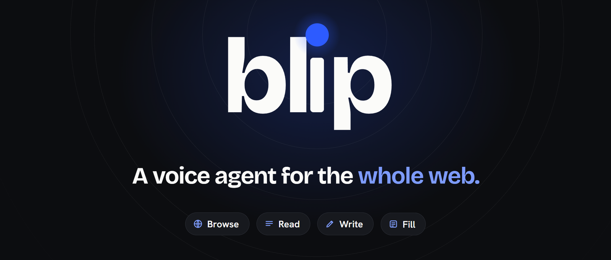
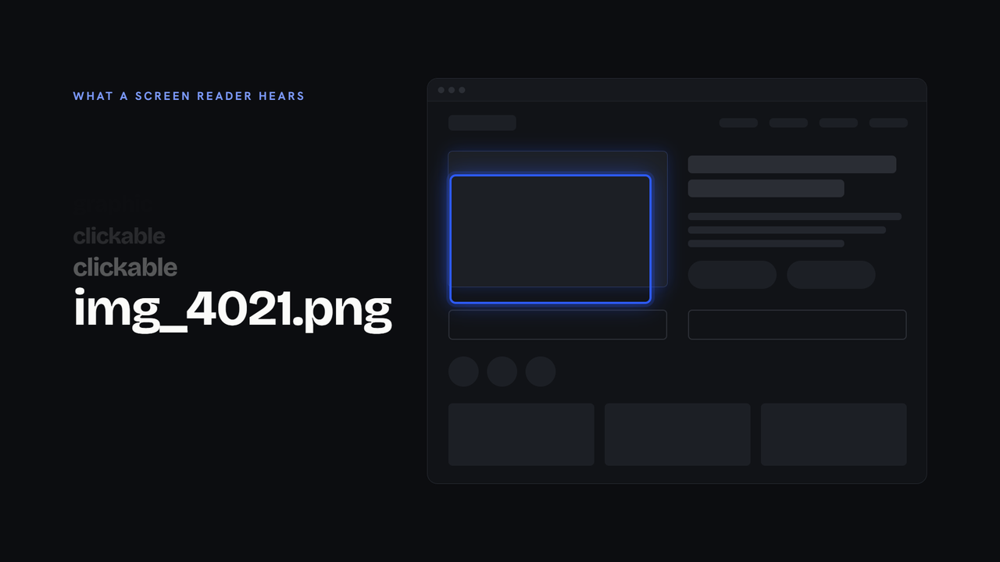
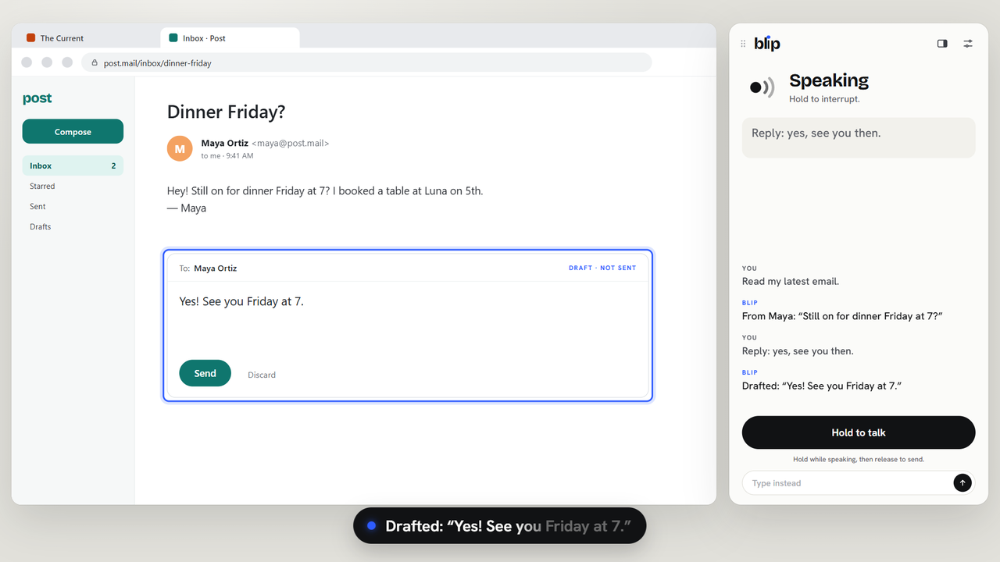
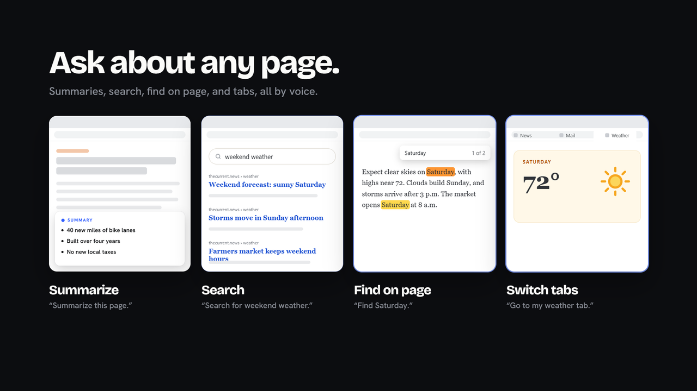
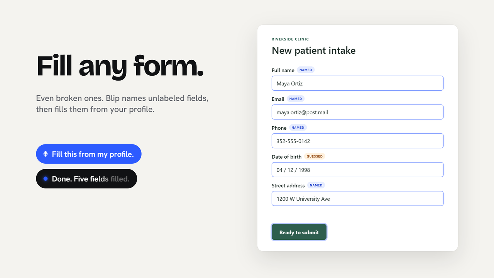
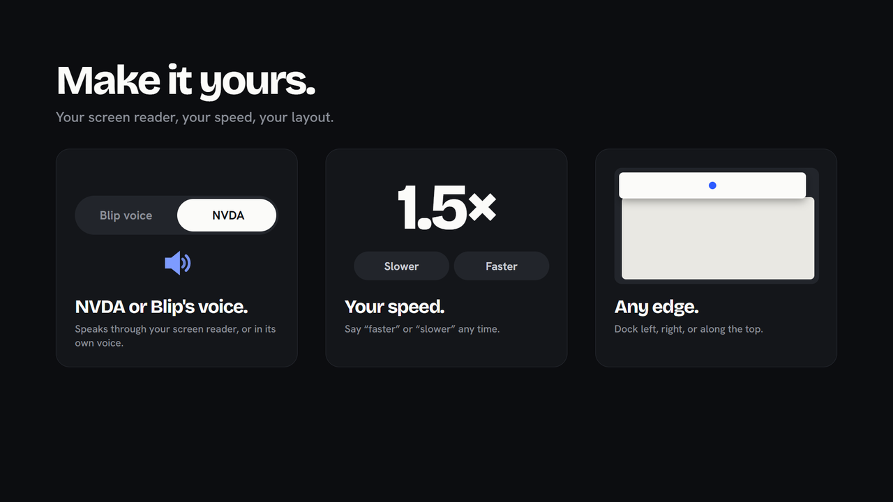
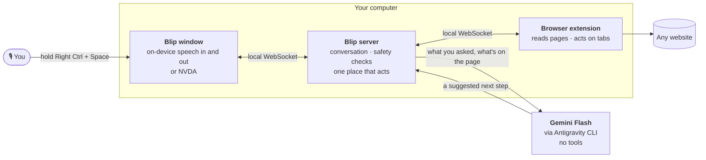
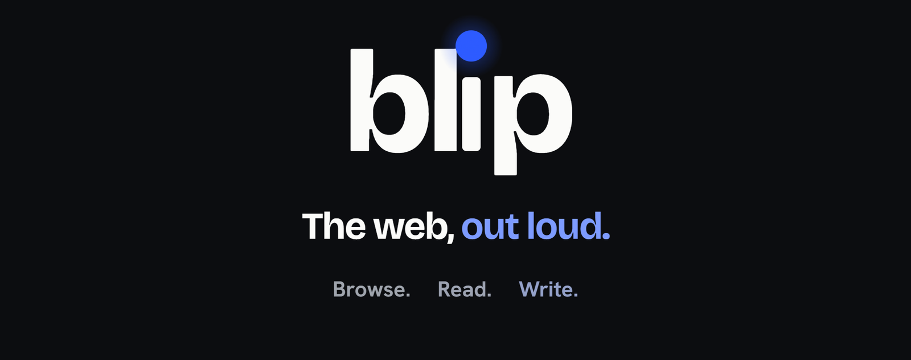

<div align="center">



<h3>Browse, read, write, and fill out forms on any website, just by talking.</h3>

<p>Blip is a voice agent for blind and low-vision people. Ask it to read your latest email, summarize a page, draft a reply, or fill a form. It works in your own browser, alongside your screen reader, and never acts on anything important without your exact words.</p>

<p>
<a href="LICENSE"></a>


</p>

<p>
<a href="#see-it-in-action"><b>Demo</b></a> ·
<a href="#what-blip-can-do"><b>Features</b></a> ·
<a href="#quick-start"><b>Quick start</b></a> ·
<a href="#how-it-works"><b>How it works</b></a> ·
<a href="#talk-to-it"><b>Commands</b></a>
</p>

</div>

<br>

## See it in action

https://github.com/user-attachments/assets/9e7b54d5-4080-435f-b17f-f572c0eaf2ee

> *"Read my latest email."* · *"Reply: yes, see you then."* · *"Make it 7:30."* · *"Send this email."*
>
> One conversation, start to finish. Blip finds the right tab, reads the message, writes the reply, takes your edit, and sends only when you say the words.

<br>

## Why Blip



**95.9% of the top million home pages have detectable accessibility failures** ([WebAIM Million, 2026](https://webaim.org/projects/million/)). To a screen reader, much of the web sounds like *"button, button, unlabeled, img_4021.png."*

Screen readers read what a page *says*. Blip understands what a page *means*, then lets you act on it in plain language. You stay in charge of every step.

<br clear="right">

<br>

## What Blip can do

<table>
<tr>
<td width="50%" valign="top">

<h3>Read and reply</h3>
Ask for your latest email and Blip switches to the right tab, finds it, and reads it to you. Dictate a reply, change it in your own words, and hear the final draft before anything is sent.
</td>
<td width="50%" valign="top">

<h3>Ask about any page</h3>
Summaries, site search, find on page, scrolling, links and tabs, all by voice. Blip works from what is actually on the page and tells you when it isn't sure.
</td>
</tr>
<tr>
<td width="50%" valign="top">

<h3>Fill any form, even broken ones</h3>
Blip names unlabeled fields from the page structure, says when it had to guess, and fills them from your local profile. It reads every value back before you submit.
</td>
<td width="50%" valign="top">

<h3>Make it yours</h3>
Speak through NVDA or in Blip's own voice. Say "faster" or "slower" any time. Dock the Blip window to the left, right, or top of your screen.
</td>
</tr>
</table>

<br>

## Talk to it

Hold **Right Ctrl + Space** anywhere (or use *Hold to talk*), speak, and let go. You can also type.

| Say | Blip |
|---|---|
| *"What's here?"* | Describes the page: what it is, its sections, and any form fields |
| *"Read my latest email."* | Finds the newest visible item and reads it |
| *"Summarize this page."* | Gives a short summary of what's on screen |
| *"Search for weekend weather."* | Uses the site's own search |
| *"Find Saturday."* | Finds text on the page |
| *"Switch to my mail tab."* | Switches tabs |
| *"Reply: yes, see you then."* | Drafts a reply, then reads it back |
| *"Make it 7:30."* | Revises the current draft |
| *"Fill from my profile."* | Fills matching fields from your local profile |
| *"Read back."* | Reads every field and value, calling out anything still empty |
| *"Spell email."* | Spells a value letter by letter |
| *"Undo"* · *"Stop"* | Takes back the last change or stops speaking |
| *"Faster"* · *"Slower"* | Changes Blip's speaking speed |

When an action matters (sending, submitting, opening a new site), Blip tells you exactly what to say, such as *"send this email"*. A bare "yes" is never enough.

<br>

## Quick start

**You'll need:** Windows 10 or 11 · [Node.js 24+](https://nodejs.org/) · Chrome or Edge · the [Antigravity CLI](https://www.antigravity.google/docs/cli/headless/), signed in once with `agy` · [NVDA](https://www.nvaccess.org/download/) (optional)

```powershell
git clone https://github.com/swilled/blip.git
cd blip
npm install
npm start
```

`npm start` builds everything, starts Blip on your computer, and opens the Blip window.

**One-time extension setup:** open `chrome://extensions` (or `edge://extensions`), turn on **Developer mode**, choose **Load unpacked**, and select the `apps/extension/dist` folder. The terminal prints *"Browser extension connected"* when Blip can see your tabs.

Then press **Space** in the Blip window to start, and hold **Right Ctrl + Space** to talk.

<details>
<summary><b>More options</b></summary>
<br>

| Command | What it does |
|---|---|
| `npm start -- --brain=fake` | Runs offline with a built-in rule-based brain (no Antigravity sign-in) |
| `npm start -- --no-window` | Restarts the service and reuses an open Blip tab |
| `npm run demo -- --brain=fake` | Runs the local demo with sample pages in a separate browser profile ([guide](docs/demo.md)) |

Speech recognition (Moonshine) and Blip's voice (Kokoro) run on your device. The first launch downloads their models once; after that they work offline. To use NVDA instead of Blip's voice, open **Settings → Speech output** in the Blip window.

</details>

<br>

## How it works



- **The Blip window** captures your voice while you hold the keys, transcribes it on your device, and speaks replies in Blip's voice or through NVDA.
- **The browser extension** reads each page the way assistive technology sees it (the accessibility tree plus the page structure), then carries out actions like typing, clicking, scrolling, and switching tabs.
- **The Blip server** runs the conversation. It turns your words into one clear next step, checks it, and carries it out through a single action path.
- **Gemini Flash** helps understand open-ended requests and repair badly labeled pages. It only suggests a next step as data; it has no tools and cannot touch the browser.

### Built to be trusted

- **You confirm what matters.** Sending, submitting, and opening new sites wait for a specific phrase after a full read-back.
- **The AI suggests, code decides.** Every action goes through deterministic checks the model cannot skip.
- **Pages can't give orders.** Text on a website is treated as content, never as instructions.
- **Your secrets stay yours.** You type passwords and card numbers yourself. Blip never speaks, logs, or sends them to the model.

<br>

## Project layout

| Path | What's inside |
|---|---|
| [`apps/voice`](apps/voice) | The Blip window: push-to-talk, on-device speech, NVDA output, captions and history |
| [`apps/server`](apps/server) | The local server: conversation, model provider, safety checks, and the action path |
| [`apps/extension`](apps/extension) | The Chrome/Edge extension that reads pages and acts on tabs |
| [`packages/protocol`](packages/protocol) | The shared message contract, validated on both ends ([PROTOCOL.md](PROTOCOL.md)) |
| [`packages/dialogue`](packages/dialogue) | Read-back and confirmation flow |
| [`packages/policy`](packages/policy) | Rules for which actions need your confirmation |
| [`tools/test-pages`](tools/test-pages) | Sample pages for testing, including deliberately broken forms |

## Development

```powershell
npm test            # run the test suite
npm run typecheck   # type-check every workspace
npm run dev         # server + simulated extension + a typed command console
```

See [CONTRIBUTING.md](CONTRIBUTING.md) for how to work on Blip.

## What's next

- Testing with blind and low-vision users, and shaping Blip around what they need
- Support for custom date pickers, comboboxes, and other tricky widgets
- An encrypted profile for saved details
- A Chrome Web Store release, so setup is one click

## Credits

Blip's voice is [Kokoro](https://github.com/hexgrad/kokoro) (Apache-2.0), its ears are [Moonshine](https://github.com/moonshine-ai/moonshine), and its interface sounds are by [Kenney](https://kenney.nl/) (CC0). Screen reader output uses the [NVDA Controller Client](https://github.com/nvaccess/nvda/tree/master/extras/controllerClient). Blip started at GatorHacks 2026.

Released under the [MIT License](LICENSE).

<br>

<div align="center">

</div>
